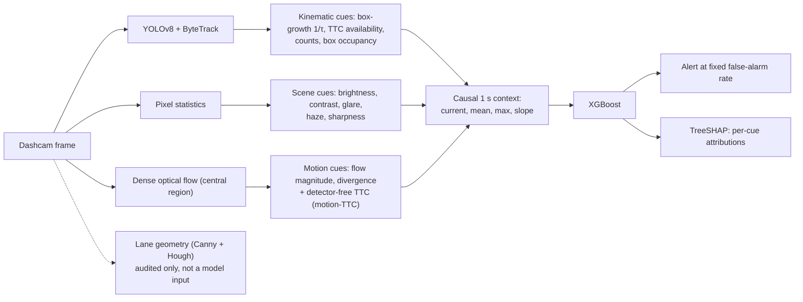

# DriveSense — Bias-Aware Evaluation of Interpretable Dashcam Cues for Collision Anticipation
 
[](https://python.org)
[](https://ultralytics.com)
[](https://xgboost.readthedocs.io)
[](https://shap.readthedocs.io)
 
Code, per-clip features and results for the paper:
 
> **Does Early Warning Survive Source and Position Controls? A Bias-Aware Evaluation of Interpretable Dashcam Cues on the Car Crash Dataset**
> Siddhi Dhoke — Indian Institute of Information Technology Nagpur
> Prepared for **IRIS 2027** (IIT Madras, Shaastra); proceedings in Springer *Lecture Notes in Electrical Engineering*, subject to Springer review.
 
**DriveSense** is a lightweight, interpretable pipeline for single-dashcam collision anticipation: YOLOv8 + ByteTrack, two calibration-free time-to-contact (TTC) cues (from box growth and from optical-flow divergence), scene and flow statistics, and gradient-boosted trees with TreeSHAP. We use it as a probe to ask a different question: **do high anticipation scores on the Car Crash Dataset (CCD) actually measure early-warning ability?**
 
---
 
## TL;DR
 
On CCD, three different findings are routinely conflated. We test them separately:
 
| Level | Question | Answer on CCD |
|---|---|---|
| **1. Dataset discrimination** | Can a model separate accident from normal clips? | Yes, almost perfectly — but largely by *source*. Encoding statistics of the **first second** (before any accident) give test AUC **1.00**. |
| **2. Within-accident temporal association** | Do cues change as a collision approaches? | Yes: detection coverage falls and central flow magnitude rises toward impact, more than in normal clips — but open to residual source effects. |
| **3. Early-warning capability** | Does a score rise before the accident in a way that survives source and position controls? | **Not demonstrated.** Time since clip start alone gives AUC **0.99**; with clip time matched, the fused AUC falls from 0.92 to **0.63** (95% CI [0.53, 0.72]). |
 
**Early-warning claims on CCD should be backed by source- and position-controlled evaluation.** This repository provides that evaluation.
 
### Contributions
1. A **bias-aware evaluation protocol** testing the three levels separately: a first-second leakage test, a crash-versus-normal control of cue dynamics, and a within-accident protocol with clip-position controls.
2. A **quantitative decomposition of CCD source bias** by cue family (encoding, scene, kinematic, motion).
3. A **reliability analysis of interpretable cues**: two calibration-free TTC cues, effect sizes for 14 cues, kinematic ablations, and TreeSHAP attributions that *explain* a clip-start shortcut.
### Positive results that remain
- A reusable protocol and per-cue effect sizes.
- Central flow magnitude rises and detection coverage falls toward impact more in accident than in normal clips.
- Box-growth TTC has the highest single-group AUC under time matching (0.67, 95% CI [0.58, 0.75]) — a lead for future work, not evidence of early warning.
- Released code, per-clip features and results.
---
 
## Pipeline
 

 
Every cue uses current and past frames only. The pipeline runs at about **100 ms per frame** (~10 fps) on a laptop RTX 4060.
 
### Calibration-free time-to-contact
 
For an object of image size $s(t)=fS/Z(t)$ under a pinhole camera, the focal length $f$ and the unknown physical size $S$ cancel:
 
$$\frac{d\ln s}{dt} = -\frac{\dot Z}{Z} = \frac{1}{\tau}, \qquad \tau = -\frac{Z}{\dot Z}$$
 
Per track, $s=\sqrt{wh}$ (vehicles) or $s=h$ (vulnerable road users); $1/\tau$ is the least-squares slope of $\ln s$ over the last 0.6 s (≥ 4 samples). The per-frame cue is the largest $1/\tau$ among **in-path** tracks (center within ±0.22 W of the image center, bottom edge in the lower half of the frame).
 
### Detector-free TTC from optical-flow divergence
 
Dense Farnebäck flow on frames downscaled 4× per side (320×180 for 1280×720 video; flow in pixels/frame at this resolution) gives the central divergence $D=\partial u/\partial x+\partial v/\partial y$. For a surface approaching at constant speed it equals $2/\tau$ per second:
 
$$\tau_{\mathrm{div}} = \frac{2}{F\,\max(\bar D,\epsilon)},\quad F=10\ \text{frames/s},\ \tau_{\mathrm{div}}\in[0.1,10]\ \text{s}$$
 
### Model
Each base cue gets four causal context features over the last second (current, mean, maximum, slope; the window is incomplete in the first nine frames of a clip). Cue groups: **kinematic**, **scene**, **motion**, **motion-TTC**. XGBoost: 300 trees, depth 4, learning rate 0.05, class-balanced; scores averaged over the last three frames; alert when the smoothed score first exceeds a threshold fixed on held-out clips. TreeSHAP attributions are summed over a cue's four context features; they describe what the fitted model uses, **not** what causes an accident. Lane geometry is audited but not used by any model.
 
---
 
## Data and protocol
 
| Item | Detail |
|---|---|
| **CCD** | 1,500 accident clips (YouTube) + 3,000 normal clips (BDD100K), each 5 s at 10 fps. Accident onset, day/night, weather and ego involvement are annotated. Onsets lie between 3.0 and 4.9 s (CCD places each onset in the last 2 s). |
| **Split** | Official lists: 3,600 train / 900 test clips (300 accident in test). 20% of training clips are held out to fix every threshold. |
| **Normal clips** | Deterministic pseudo-onset drawn from the accident-onset distribution. |
| **Uncertainty** | 95% CIs from 1,000 bootstrap resamples of **clips**. Holm correction for the cue-level tests. |
| **Level 1** | Clip score = max smoothed frame score before (pseudo-)onset; AP, ROC-AUC; at a 10% false-alarm threshold: recall, mTTA, share alerted ≥ 1 s ahead. **Leakage test:** cue means over the first second only, plus *encoding cues* (file size, bit rate, bits per pixel, resolution, block artifacts, noise estimate, letterbox borders, frame difference). |
| **Level 2** | Change of each cue from an early ([−3, −2) s) to a late ([−1, 0) s) window relative to the (pseudo-)onset. Wilcoxon within accident clips; Mann–Whitney + rank-biserial $r_{rb}$ accident vs normal. |
| **Level 3** | Accident clips only: frames > 2 s before onset = negative (far), last second = positive (near). Controls: **(a)** time-only baseline, **(b)** complete-context restriction (t ≥ 0.9 s; also t ≥ 1.5 s), **(c)** **time-matched** evaluation on t ∈ [2.0, 2.9] s with negatives reweighted to the positive time distribution (time-only AUC is 0.5 by construction). |
 
---
 
## Results
 
### Level 1 — Source leakage (first second only, before any accident)
 
| Cues (first second) | Test AUC [95% CI] |
|---|---|
| Encoding only | 1.00 [1.00, 1.00] |
| Scene only | 0.93 [0.91, 0.95] |
| Kinematic only | 0.73 [0.70, 0.77] |
| Motion only | 0.70 [0.66, 0.73] |
| All visual cues | 0.96 [0.95, 0.97] |
| Visual + encoding | 1.00 [1.00, 1.00] |
 
Median bit rate: 105 kB/s (accident) vs 369 kB/s (normal), a factor of 3.5; all normal clips are 1280×720 while 35 accident clips are not; median noise estimate 0.0 (accident) vs 1.5 (normal). Matching accident and normal clips by encoding is infeasible (12 pairs within the caliper).
 
### Level 1 — Accident vs normal anticipation (source-confounded)
 
Thresholds fixed at a 10% false-alarm rate on held-out training clips; CCD test set.
 
| Method | AP [95% CI] | AUC | FAR % | Recall % [95% CI] | mTTA (s) | R@1s % |
|---|---|---|---|---|---|---|
| Rule: box-TTC (tuned) | 0.40 [0.36, 0.44] | 0.57 | 10 | 16 [12, 19] | 2.23 | 13 |
| Rule: box-TTC < 2 s (fixed) | 0.40 [0.36, 0.44] | 0.57 | 34 | 49 [43, 54] | 2.27 | 40 |
| Rule: flow-divergence TTC (tuned) | 0.39 [0.36, 0.43] | 0.58 | 9 | 14 [10, 18] | 1.35 | 8 |
| Scene only | 0.91 [0.89, 0.93] | 0.95 | 12 | 88 [84, 91] | 3.20 | 84 |
| Kinematic only | 0.79 [0.75, 0.83] | 0.87 | 10 | 62 [56, 67] | 1.96 | 54 |
| Motion only | 0.66 [0.61, 0.71] | 0.79 | 10 | 44 [39, 50] | 1.29 | 22 |
| Motion-TTC only | 0.47 [0.43, 0.53] | 0.67 | 9 | 23 [19, 28] | 1.54 | 16 |
| Kinematic + motion | 0.84 [0.80, 0.87] | 0.90 | 9 | 70 [64, 75] | 1.95 | 59 |
| Fused (kinematic + scene + motion) | 0.97 [0.96, 0.98] | 0.98 | 9 | 95 [92, 97] | 2.92 | 93 |
 
The fused model's high AP **mainly reflects source recognition**: scene cues alone reach AP 0.91, and the mTTA is close to its ceiling — test onsets average 3.69 s (the lead time from alerting at the first frame), so the fused model fires, on average, within roughly the first second of a clip. Fused recall by slice: day/night 97%/81% (n_night = 36); normal weather/rain/snow 95/89/96%; with/without ego involvement 97/93%. All slices share the BDD100K normal clips and the source confound.
 
### Level 2 — Which cues change toward impact?
 
Per-cue evidence on 1,500 accident and 3,000 normal clips (not source-free). $r_{rb}$: rank-biserial correlation of the early→late change, accident vs normal (positive = larger change in accident clips).
 
| Cue | Accident: median change (Holm p) | $r_{rb}$ | Reading |
|---|---|---|---|
| Any detection (frame share) | 0.00 (< 0.001) | −0.37 | falls more; moderate |
| Vehicles per frame | −0.90 (< 0.001) | −0.41 | falls more; moderate |
| VRUs per frame | 0.00 (< 0.001) | −0.08 | negligible |
| Box area fraction | −0.0033 (< 0.001) | −0.18 | falls more; small |
| In-path box TTC (frame share) | 0.00 (< 0.001) | −0.24 | falls more; small |
| Max in-path box 1/τ | 0.00 (0.01) | −0.11 | falls more; small |
| **Central flow magnitude** | **+0.43 (< 0.001)** | **+0.33** | **rises more; moderate** |
| Central divergence, mean | −2.2e−5 (0.49) | +0.05 | negligible |
| Central divergence, P90 | – | +0.32 | rises more; moderate |
| Brightness | −0.0036 (< 0.001) | −0.13 | small |
| Contrast | +0.00049 (0.15) | +0.03 | no difference |
| Glare fraction | −6.4e−5 (< 0.001) | −0.09 | negligible |
| Sharpness (Laplacian var.) | −7.66 (< 0.001) | −0.12 | small |
| Dark channel | −0.0046 (< 0.001) | −0.14 | small |
 
Highlights: central flow rises from 1.36 to 2.19 px/frame in accident clips but only 1.53 to 1.59 in normal clips; detection coverage falls from 0.81 to 0.59 in accident clips vs 0.90 to 0.89 in normal clips; box-growth 1/τ does **not** rise. Lane markings are unreliable (both boundaries found in only 9.3% of accident frames, 4.3% in snow, and in any frame of only 37% of clips). A τ < 2 s box-TTC rule fires in 11.2% of early vs 10.9% of late frames.
 
### Level 3 — Within-accident discrimination with clip-position controls
 
Frame-level test AUC on the 300 test accident clips (near: last 1 s; far: > 2 s before onset).
 
| Score | Original | Complete context (retrained) | Time-matched, retrained [95% CI] | Time-matched, original model [95% CI] |
|---|---|---|---|---|
| **Time since clip start** | **0.99** | **0.98** | 0.47 [0.42, 0.56] | – |
| Kinematic (full) | 0.87 | 0.77 | 0.62 [0.53, 0.71] | 0.56 [0.46, 0.66] |
| Kinematic w/o box growth | 0.81 | – | 0.54 [0.44, 0.66] | – |
| Detections + counts | 0.80 | 0.68 | 0.56 [0.46, 0.67] | 0.47 [0.36, 0.58] |
| Box occupancy | 0.77 | – | 0.58 [0.45, 0.70] | – |
| Box-growth TTC | 0.77 | 0.71 | **0.67 [0.58, 0.75]** | 0.60 [0.51, 0.69] |
| Motion (flow) | 0.79 | 0.67 | 0.52 [0.40, 0.62] | 0.57 [0.48, 0.66] |
| Motion-TTC | 0.82 | – | 0.50 [0.41, 0.57] | – |
| Scene | 0.80 | 0.72 | 0.53 [0.41, 0.66] | 0.57 [0.48, 0.65] |
| **Fused (kinematic + scene + motion)** | **0.92** | 0.85 | **0.63 [0.53, 0.72]** | 0.60 [0.53, 0.68] |
 
Untrained rules (original protocol): box-growth rule 0.45 [0.43, 0.48] (slightly *below* chance), flow-divergence rule 0.56 [0.54, 0.59]. Fused AUC with complete-context negatives is 0.85 (0.79 for t ≥ 1.5 s) while time alone still gives 0.98.
 
**Reading:** the original within-accident result (0.92) mostly reflects *where a frame lies in the clip*. In the time-matched evaluation, 87 of the 300 test accident clips (onset ≥ 4.1 s) contribute negatives and 202 clips (onset ≤ 3.9 s) contribute positives, with no clip in both — so near and far frames come from different clips. The residual signal (0.63) is weak and uncertain; box-growth TTC's 0.67 is **a lead, not evidence of early warning**.
 
### Explanations (TreeSHAP) expose the shortcut
For the original fused within-accident model, far frames in the first 0.9 s receive a mean total attribution of **−3.18** log-odds, against −0.55 for later far frames and +1.31 for near frames. 71% of the attribution falls on 1-s mean and slope features, which are incomplete at clip start; the largest negative attributions go to cues with clip-start transients (no box growth before frame 3, no flow at frame 0, tracker initialization). In a representative test clip the score climbs from the clip start rather than at an event.
 
> **How the shortcut was found:** the time-only baseline exposed it; the attributions showed *how* the model used it.
 
---
 
## Limitations
 
- **Source confound.** Accident and normal clips differ in source, so every crash-versus-normal comparison (including Level 2) is confounded. A matched-source normal and hard-braking set (same cameras, uploads and encoders, aligned to braking onset) is needed to attribute cue changes to the approaching collision.
- **Time-matched evaluation** rests on 87 late-onset clips with negatives and 202 early-onset clips with positives, which may differ in content.
- CCD clips last **5 s**, capping lead time.
- Detector and tracker losses were **not separated**; box-growth TTC was **not validated against measured range**.
- Each model was **trained once** (no seed variance).
- **No new deep model** was trained; published CCD results may not be comparable given these confounds.
- **Only CCD** was evaluated; whether the position confound affects other anticipation datasets is untested.
- **Level 3 CIs are not corrected** for multiple comparisons across the cue groups and protocols.
---
 
## Repository structure
 
```
DriveSense/
├── experiments/
│   ├── exp3_ccd/                  # CCD audit and the three-level evaluation (paper results)
│   │   ├── perception/            # YOLOv8 + ByteTrack, optical flow, scene, kinematics
│   │   ├── 00_inspect_ccd.py
│   │   ├── 00b_build_crash_table.py
│   │   ├── 01_extract_features.py
│   │   ├── 02_build_video_features.py
│   │   ├── 03_temporal_analysis.py
│   │   ├── 04_anticipation_eval.py        # Level 1 (leakage test + accident-vs-normal)
│   │   ├── 06_within_clip.py              # Level 3 (within-accident protocol)
│   │   ├── 08_runtime.py
│   │   ├── 09_extra_macros.py
│   │   ├── 10_within_robustness.py        # time controls, ablations, TreeSHAP figure
│   │   ├── 11_cue_table.py                # Level 2 per-cue table
│   │   ├── config.py, utils.py
│   │   ├── README_exp3.md                 # full ordered list of scripts
│   │   └── results/                       # per-clip features, result CSV/JSON
│   └── exp1_crss/                 # supplementary CRSS experiment (NOT part of the IRIS paper)
├── paper/                         # LaTeX source; every number is auto-generated from the scripts above
│   └── scripts/pilot.py           # audit of all 1,500 accident clips
├── docs/
└── legacy/                        # retired prototype — see note below
```
 
> **Legacy prototype.** An early version of this repository (dashboard + "Models A/B/C") was trained on **synthetic labels computed as a formula of the input features**, so its reported "fusion lift" reproduced the label generator, not real-world behaviour. Its probabilities are **not validated** and saturate on real footage. It is kept in `legacy/` for reference only; none of its results appear in the paper, and the real-label, clip-level protocol above was designed in response to it.
 
---
 
## Reproducing the results
 
```bash
# 1. Environment (Python 3.12+)
python -m pip install -r experiments/exp3_ccd/requirements_exp3.txt
 
# 2. Data — NOT redistributed here; obtain from the providers and follow their licenses
#    CCD (includes the BDD100K normal clips): https://github.com/Cogito2012/CarCrashDataset
 
# 3. Feature extraction and audit
python experiments/exp3_ccd/00_inspect_ccd.py
python experiments/exp3_ccd/00b_build_crash_table.py
python experiments/exp3_ccd/01_extract_features.py
python experiments/exp3_ccd/02_build_video_features.py
python experiments/exp3_ccd/03_temporal_analysis.py
 
# 4. Three-level evaluation and figures/tables
python experiments/exp3_ccd/04_anticipation_eval.py
python experiments/exp3_ccd/06_within_clip.py
python experiments/exp3_ccd/10_within_robustness.py
python experiments/exp3_ccd/11_cue_table.py
python experiments/exp3_ccd/08_runtime.py
python experiments/exp3_ccd/09_extra_macros.py
python paper/scripts/pilot.py <results_dir> paper/
#    See experiments/exp3_ccd/README_exp3.md for the authoritative script order.
 
# 5. Build the paper (needs Springer's svproc class from the LNEE proceedings template)
cd paper && pdflatex main && pdflatex main
```
 
**Reproducibility notes:** official CCD train/test lists; clip-level splits (never frame-level); thresholds fixed on held-out training clips; 1,000-resample bootstrap over clips; Holm correction for the cue-level tests; every number in the paper comes from an auto-generated macro file. Per-clip feature tables and result CSVs are included under `experiments/exp3_ccd/results/`.
 
---
 
## Data and licensing
 
CCD and BDD100K are **not redistributed** here and no dataset frames are included. Obtain them from their providers and follow their licenses. Check each dataset's license before using its frames in any publication.
 
---
