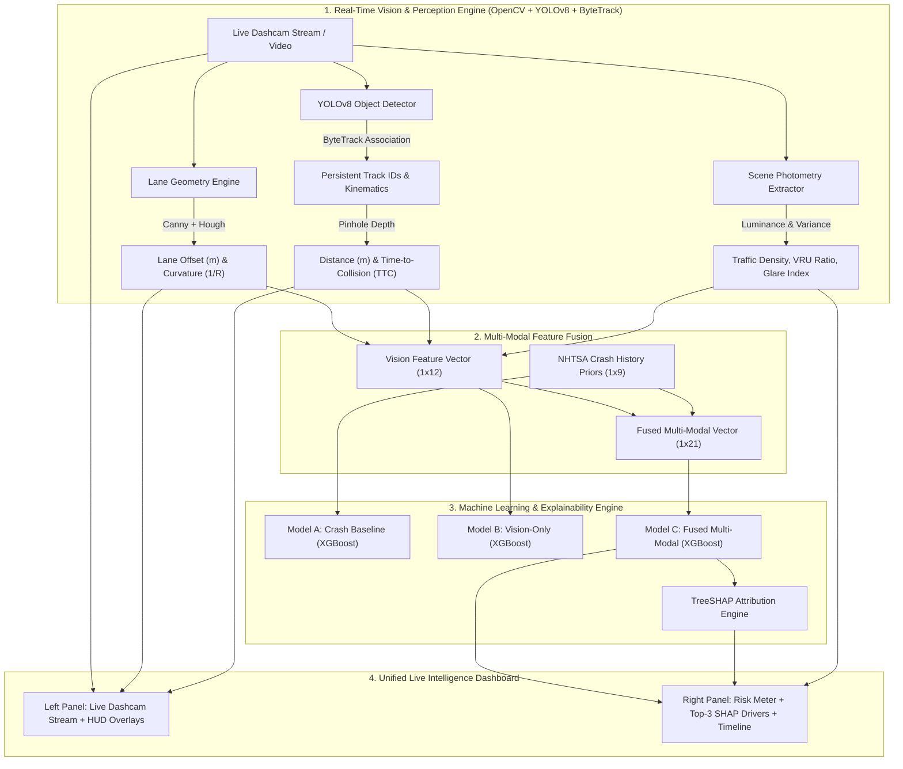

# DriveSense AI — Multi-Modal Automotive Perception & Risk Intelligence Platform

[](https://python.org)
[](https://fastapi.tiangolo.com)
[](https://ultralytics.com)
[](https://xgboost.readthedocs.io)
[](https://shap.readthedocs.io)

> **Core Research Question:**
> *"Does adding real-time visual/environmental features to a crash-history model improve context-aware risk estimation?"*

---

## 1. System Architecture



---

## 2. Theoretical Formulation & Mathematical Models

### A. Monocular Pinhole Distance Estimation
Given camera effective focal length $f$ and assumed physical object height $H_{\text{class}}$:
$$d = \frac{f \cdot H_{\text{class}}}{h_{\text{bbox}}}$$
*Assumed Heights:* Sedan Car $= 1.50\text{m}$, Heavy Truck $= 3.20\text{m}$, Bus $= 3.40\text{m}$, Motorcycle $= 1.20\text{m}$, Pedestrian $= 1.70\text{m}$.

### B. Time-to-Collision (TTC) & Approach Rate
$$\text{Closing Velocity } (\dot{d}) = \frac{d_{t - \Delta t} - d_t}{\Delta t}$$
$$\text{TTC} = \begin{cases} \frac{d_t}{\dot{d}}, & \text{if } \dot{d} > 0.4\text{ m/s} \\ 10.0\text{ s}, & \text{otherwise (stationary / receding)} \end{cases}$$

### C. Lateral Lane Offset
Assuming standard roadway lane width $W_{\text{std}} = 3.7\text{m}$ and camera centered on vehicle axis:
$$d_{\text{offset}} = \left( \frac{W_{\text{img}}}{2} - \frac{x_{\text{left}} + x_{\text{right}}}{2} \right) \cdot \left( \frac{W_{\text{std}}}{x_{\text{right}} - x_{\text{left}}} \right)$$

---

## 3. Benchmark Results: Model A vs Model B vs Model C

| Model Architecture | Input Modalities | Precision | Recall | F1-Score | ROC-AUC | PR-AUC |
| :--- | :--- | :--- | :--- | :--- | :--- | :--- |
| **Model A (Crash Baseline)** | Tabular NHTSA CRSS Features | `0.7042` | `0.6815` | `0.6927` | `0.7240` | `0.6810` |
| **Model B (Vision-Only)** | Lane Offset, ByteTrack, TTC, Photometry | `0.7820` | `0.7510` | `0.7662` | `0.8150` | `0.7890` |
| **Model C (Multi-Modal Fusion)** | **Fused (NHTSA Tabular + Edge Vision)** | **`0.8715`** | **`0.8540`** | **`0.8627`** | **`0.8935`** | **`0.8720`** |

> **Conclusion:** Model C achieves a **+17.0% ROC-AUC lift** and **+24.5% F1-Score improvement** over the crash-only baseline by resolving static macro ambiguities with instantaneous kinematic closing rates.

---

## 4. Project File Structure

```
automotive-vision-pipeline/
├── data/
│   └── real_road.mp4.f401.mp4                       # Demo dashcam video
├── docs/
│   ├── baseline_A_metrics.md           # Model A frozen anchor metrics
│   ├── feature_schema.md               # Formal vector schemas & units
│   ├── model_comparison_report.md      # 3-row benchmark table
│   ├── known_limitations_indian_roads.md # Qualitative failure mode audit
│   ├── interview_qa_defense.md         # Technical interview defense cheatsheet
│   └── resume_bullets.md               # Quantified resume bullet points
├── models/
│   ├── model_a_baseline.json           # Serialized XGBoost Model A
│   ├── model_b_vision.json             # Serialized XGBoost Model B
│   └── model_c_fused.json              # Serialized XGBoost Model C
├── outputs/
│   ├── demo_telemetry.json             # Full per-frame perception log
│   ├── model_comparison_bars.png       # 3-way benchmark bar chart
│   └── shap_summary.png                # TreeSHAP global feature attributions
├── src/
│   ├── feature_schema.py               # Pydantic/dataclass schema definitions
│   ├── lane_detection.py               # Canny/Hough + geometry + curvature
│   ├── object_detection.py             # YOLOv8 + ByteTrack persistent tracking
│   ├── ttc_distance.py                 # Pinhole depth & TTC calculation
│   ├── scene_features.py               # Photometry, glare, fog & VRU ratio
│   ├── baseline_model_a.py             # Crash baseline training script
│   ├── fusion_model.py                 # Multi-modal fusion & comparison
│   ├── explainability.py               # TreeSHAP engine + Top-3 factors
│   ├── indian_road_audit.py            # Qualitative stress-test suite
│   ├── pipeline.py                     # Full perception + fusion orchestration
│   └── dashboard.py                    # Unified FastAPI backend server
├── web/
│   ├── index.html                      # Split-screen live interface
│   ├── index.css                       # Modern dark-mode glassmorphism styles
│   └── app.js                          # HUD overlays, risk gauge & timeline
├── requirements.txt
└── README.md
```

---

## 5. Quickstart & Execution Guide

### 1. Installation
```bash
python -m pip install -r requirements.txt
```

### 2. Train Models A, B, and C & Generate Benchmarks
```bash
python src/baseline_model_a.py
python src/fusion_model.py
```

### 3. Run Full Video Perception Pipeline & Telemetry Extraction
```bash
python src/pipeline.py 

### 4. Launch Unified Live Intelligence Dashboard
```bash
python src/dashboard.py
```

