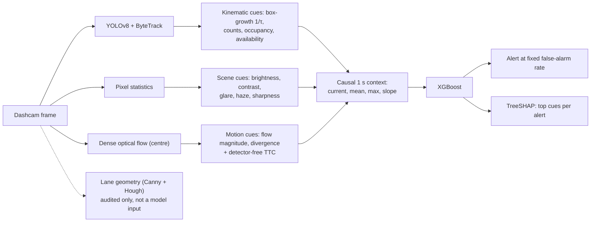

# DriveSense — An Explainable Baseline for Early Collision Anticipation from Dashcam Video

[](https://python.org)
[](https://ultralytics.com)
[](https://xgboost.readthedocs.io)
[](https://shap.readthedocs.io)

DriveSense is a lightweight, **explainable** baseline for early collision anticipation from a single forward-facing dashcam. It combines YOLOv8 detection with ByteTrack tracking, a **calibration-free time-to-contact (TTC)** cue from the growth of tracked boxes, a **detector-free TTC** from optical-flow divergence, photometric scene descriptors and central optical flow, fused by gradient-boosted trees with TreeSHAP attributions.


## Key findings

| # | Finding | Evidence |
|---|---|---|
| 1 | **CCD accident and normal clips are separable by how they were recorded, before any accident happens.** | Using only the first second of each clip, encoding properties give test AUC **1.00**, scene cues 0.93, all visual cues 0.96. |
| 2 | **Crash-versus-normal scores on CCD should not be read as anticipation skill.** | Fused model AP 0.97, but scene cues alone reach AP 0.91 and dominate TreeSHAP attribution. |
| 3 | **A within-accident protocol removes the source difference.** | Frames more than 2 s before the onset (negative) vs the last second (positive), accident clips only: fused AUC **0.92** (95% CI [0.91, 0.93]). |
| 4 | **Box-growth TTC from a generic detector does not signal the approaching accident.** | Within-accident AUC **0.45** (slightly below chance); the in-path τ<2 s rule fires in 11.2% of early vs 10.9% of late frames. |
| 5 | **Detector coverage falls toward impact, while detector-free flow magnitude rises.** | Flow magnitude rises in 70% of accident clips (median change +0.427, 95% CI [0.347, 0.536]) and far less in normal clips (r_rb = 0.33, Holm p < 0.001). |

All results use **clip-level splits** with the official CCD lists, thresholds fixed on **held-out training clips**, and **bootstrap 95% confidence intervals** over clips (1,000 resamples).

> ### Note on an earlier prototype
> An early version of this repository reported a multi-modal "fusion lift" (Models A/B/C) and described tabular features as NHTSA CRSS. **Those results were invalid:** the training data was synthetic, with labels computed as a formula of the same input features, so the "lift" reproduced the label generator rather than real-world behaviour. That prototype and its claims have been retired. The experiments below use real data (CCD, CRSS 2024), and the synthetic-label episode is the reason this project uses a real-label, clip-level protocol.

---

## Pipeline



Every cue is computed **causally** from current and past frames.

### Calibration-free time-to-contact

Under a pinhole camera an object of physical size $S$ at depth $Z(t)$ has image size $s(t) = fS/Z(t)$. Differentiating the logarithm removes both the focal length $f$ and the unknown size $S$:

$$\frac{d\ln s}{dt} = -\frac{\dot Z}{Z} = \frac{1}{\tau}, \qquad \tau = -\frac{Z}{\dot Z}$$

For each track, $s=\sqrt{wh}$ (vehicles) or $s=h$ (vulnerable road users). $1/\tau$ is estimated as the least-squares slope of $\ln s$ over the last 0.6 s (at least four samples). The per-frame cue is the largest $1/\tau$ among in-path tracks, where a detection is "in path" if its horizontal centre is within ±0.22 W of the image centre and its bottom edge is in the lower half of the frame.

### Detector-free TTC from optical-flow divergence

Dense Farnebäck flow (OpenCV; frames shrunk, central region rows 40–90%, columns 30–70%) gives the divergence $D=\partial u/\partial x+\partial v/\partial y$. For a surface approaching at constant speed the divergence equals $2/\tau$ per unit time:

$$\tau_{\mathrm{div}} = \frac{2}{F\,\max(\bar D,\epsilon)}$$

with frame rate $F=10$ and $\tau_{\mathrm{div}}$ clipped to $[0.1, 10]$ s.

### Model and explanations

- Four cue groups: **kinematic**, **scene**, **motion**, **motion-TTC**. Each base cue gets four causal context features over the last second: current value, mean, maximum, slope.
- XGBoost (300 trees, depth 4, learning rate 0.05, class-balanced), trained on frames: positives lie within 2.0 s before the annotated onset, negatives are normal-clip frames, earlier accident frames are excluded.
- An alert fires the first time the 3-frame-averaged score exceeds a threshold chosen on held-out clips for a 10% false-alarm rate.
- **TreeSHAP** decomposes each score exactly into feature contributions; summing over a cue's four context features gives cue-level attributions (additive, not causal).
- Lane geometry (Canny + Hough) is **audited but not used by the models**, because it failed on most accident clips.

---

## Data and protocol

| Item | Detail |
|---|---|
| **CCD** | 1,500 accident clips (YouTube) + 3,000 normal clips (BDD100K); each 5 s at 10 fps; accident onset, day/night, weather and ego involvement annotated |
| **Split** | Official lists: 3,600 train / 900 test clips (300 accident in test). 20% of training clips are held out to fix every threshold |
| **Normal-clip alignment** | Each normal clip gets a deterministic pseudo-onset drawn from the empirical accident-onset distribution |
| **Clip score** | Maximum smoothed frame score before the (pseudo-)onset |
| **Metrics** | AP, ROC-AUC; at the 10% FAR threshold: test FAR, recall, mTTA, share alerted ≥ 1 s ahead; bootstrap 95% CIs over clips |
| **Leakage test** | Cues from the **first second** of each clip only, plus *encoding cues* (file size, bits per pixel/second, resolution, block artifacts, noise, letterbox, frame difference) |
| **Within-accident protocol** | Accident clips only: frames > 2 s before onset negative, last second before onset positive, in-between ignored |
| **Control comparison** | Early ([−3, −2) s) → late ([−1, 0) s) change of each cue, accident vs normal clips; Mann–Whitney, Holm-corrected, rank-biserial effect size |
| **Audit** | Same windows on the 1,500 accident clips alone (1,325 day / 175 night; 1,141 normal weather / 235 snowy / 124 rainy); paired Wilcoxon, Holm-corrected across 14 cues |

---

## Results

### 1. Source leakage (first second of each clip only)

| Cues from the first second only | Test AUC [95% CI] |
|---|---|
| Nuisance (encoding) only | 1.00 [1.00, 1.00] |
| Scene cues only | 0.93 [0.91, 0.95] |
| Kinematic cues only | 0.73 [0.70, 0.77] |
| Motion cues only | 0.70 [0.66, 0.73] |
| All visual cues | 0.96 [0.95, 0.97] |
| Visual + nuisance | 1.00 [1.00, 1.00] |

Median bit rate is 105 kB/s for accident clips vs 369 kB/s for normal clips (×3.5); all normal clips are 1280×720 while 35 accident clips are not. Matching accident and normal clips by encoding is infeasible (out-of-fold encoding AUC 1.000; only 12 pairs fall within the caliper), so **crash-versus-normal results are treated as confounded.**

### 2. Accident vs normal clips (confounded by source)

Thresholds fixed at 10% FAR on held-out training clips; CCD test set.

| Method | AP [95% CI] | AUC | FAR % | Recall % [95% CI] | mTTA (s) | R@1s % |
|---|---|---|---|---|---|---|
| Rule: box-TTC (tuned) | 0.40 [0.36, 0.44] | 0.57 | 10 | 16 [12, 19] | 2.23 | 13 |
| Rule: box-TTC < 2 s (fixed) | 0.40 [0.36, 0.44] | 0.57 | 34 | 49 [43, 54] | 2.27 | 40 |
| Rule: flow-divergence TTC (tuned) | 0.39 [0.36, 0.43] | 0.58 | 9 | 14 [10, 18] | 1.35 | 8 |
| Scene only | 0.91 [0.89, 0.93] | 0.95 | 12 | 88 [84, 91] | 3.20 | 84 |
| Kinematic only | 0.79 [0.75, 0.83] | 0.87 | 10 | 62 [56, 67] | 1.96 | 54 |
| Motion only | 0.66 [0.61, 0.71] | 0.79 | 10 | 44 [39, 50] | 1.29 | 22 |
| Motion-TTC only | 0.47 [0.43, 0.53] | 0.67 | 9 | 23 [19, 28] | 1.54 | 16 |
| Kinematic + motion | 0.84 [0.80, 0.87] | 0.90 | 9 | 70 [64, 75] | 1.95 | 59 |
| Fused (kinematic + scene + motion) | 0.97 [0.96, 0.98] | 0.98 | 9 | 95 [92, 97] | 2.92 | 93 |
| Fused + motion-TTC | 0.97 [0.96, 0.98] | 0.98 | 10 | 95 [93, 97] | 2.88 | 93 |
| Fused, logistic regression | 0.89 [0.85, 0.93] | 0.96 | 9 | 86 [82, 90] | 2.74 | 78 |

**How to read this:** scene cues alone reproduce most of the fused score, and together with Section 1 this means these numbers mostly measure *source recognition*, not anticipation skill. TreeSHAP attribution of the fused model: 48% scene, 36% kinematic, 16% motion.

### 3. Within-accident anticipation (source removed)

300 test accident clips; frames > 2 s before onset (negative) vs the last second (positive).

| Score | AUC [95% CI] | AP | Recall % [95% CI] | mTTA (s) |
|---|---|---|---|---|
| Rule: box-TTC | 0.45 [0.43, 0.48] | 0.37 | 42 [36, 47] | 1.47 |
| Rule: flow-divergence TTC | 0.56 [0.54, 0.59] | 0.44 | 48 [42, 53] | 1.27 |
| Flow magnitude (no learning) | 0.67 [0.65, 0.70] | 0.56 | 53 [47, 58] | 1.09 |
| Scene only | 0.80 [0.77, 0.82] | 0.68 | 74 [69, 79] | 1.29 |
| Kinematic only | 0.87 [0.85, 0.89] | 0.74 | 76 [71, 80] | 1.39 |
| Motion only | 0.79 [0.76, 0.81] | 0.67 | 74 [69, 78] | 1.16 |
| Motion-TTC only | 0.82 [0.80, 0.84] | 0.65 | 87 [84, 91] | 1.47 |
| Kinematic + motion | 0.91 [0.89, 0.92] | 0.82 | 89 [86, 92] | 1.35 |
| **Fused (kinematic + scene + motion)** | **0.92 [0.91, 0.93]** | **0.86** | **90 [87, 93]** | **1.39** |

Recall is the share of test accident clips alerted within the last 2 s, with thresholds fixed at a 10% frame-level false-alarm rate on held-out far frames.

### 4. Which cues survive accident footage? (audit, 1,500 accident clips)

- **Lane markings are unreliable:** both boundaries found in only 9.3% of frames (4.3% in snow), and in any frame in only 37% of clips.
- **Detector coverage collapses toward impact:** the share of frames with any detection falls from a median of 1 to 0.7 (decrease in 48% of clips, Holm p < 0.001); vehicle counts fall from 2.4 to 1.
- **Box-growth TTC does not strengthen:** an in-path estimate exists in some frame of 1,195 of 1,500 clips, but the largest in-path 1/τ shows no increase toward impact (increase in 33%, decrease in 39% of clips).
- **Flow magnitude rises:** 1.14 → 1.75 (median change +0.427, 95% CI [0.347, 0.536]), increasing in 70% of clips (Holm p < 0.001).
- **Photometry barely moves** (≤ 3% of level), so the windows are not just lighting changes.

### 5. Control comparison: accident vs normal clips

| Cue (early → late) | Accident | Normal | Effect size |
|---|---|---|---|
| Central flow magnitude (mean) | 1.36 → 2.19 | 1.53 → 1.59 | r_rb = 0.33, Holm p < 0.001 |
| Any detection (share of frames) | 0.81 → 0.59 | 0.90 → 0.89 | r_rb = −0.37 |
| Box-growth 1/τ | 0.17 → 0.14 | — | r_rb = −0.11 |

Vehicle count r_rb = −0.41; the 90th percentile of flow divergence r_rb = 0.32. The control comparison is still subject to a residual source difference between YouTube accident clips and BDD100K normal clips (see Limitations).

### 6. How much of crash severity is camera-observable? (CRSS 2024)

XGBoost on **51,641** U.S. police-reported crashes (target: suspected serious or fatal injury, 11.2% prevalence; injury-derived inputs removed):

| Inputs | Test AUC [95% CI] |
|---|---|
| Context only | 0.612 [0.595, 0.631] |
| + road-user and vehicle types a camera could observe | 0.684 [0.668, 0.701] (paired ΔAUC +0.072, 95% CI [0.058, 0.088]) |
| Full report | 0.763 [0.749, 0.775] |

Camera-observable context recovers about **70%** of the full report's above-chance discrimination. Variables are police-coded and the target is injury severity, not collision occurrence, so this is a rough proxy for what a camera could supply, not an anticipation result.

### 7. Compute cost (laptop RTX 4060)

Detection + tracking 44 ms, scene descriptors 21 ms, optical flow 30 ms, lanes 5 ms, kinematics < 1 ms: **≈ 100 ms per frame, about 10 fps** (the CCD frame rate).

---

## Limitations

- **Single dataset (CCD).** Accident clips come from YouTube and normal clips from BDD100K, which is exactly the source difference we expose; no second dataset is evaluated yet.
- **The within-accident task is not anticipation of a clip's fate.** It asks whether the last second differs from earlier frames of the same clip, and it does not estimate false alarms on normal driving (a source-matched normal set is needed).
- **Control comparison caveat.** Accident and normal clips differ in source, so the accident-vs-normal contrast may retain a residual source effect.
- **Clip-start effects.** Tracker warm-up and the 1 s context window are incomplete at the start of a clip. A baseline using only time-since-clip-start, and an evaluation restricted to frames with a full context window, are not yet reported.
- **Detector vs tracker.** We did not separate detector from tracker losses, so the coverage collapse may be tracker-specific. Box-growth TTC was not validated against measured range.
- **5-second clips** cap lead time. Each model was trained once (no seed variance reported).
- **CRSS is U.S. police-coded data,** and dense, unmarked Indian traffic is rare in CCD.
- **No deep end-to-end baseline** is compared; published deep-model numbers on CCD face the same source confound and are not directly comparable.

---

## Repository structure

```
DriveSense/
├── experiments/
│   ├── exp1_crss/            # CRSS 2024 camera-observable-context bound (inspect → clean → train → evaluate → SHAP)
│   └── exp3_ccd/             # CCD audit, leakage test, within-accident protocol, control comparison
│       ├── perception/       # YOLOv8 + ByteTrack, optical flow, scene, kinematics
│       ├── 00_inspect_ccd.py
│       ├── 00b_build_crash_table.py
│       ├── 01_extract_features.py
│       ├── 02_build_video_features.py
│       ├── 03_temporal_analysis.py
│       ├── config.py, utils.py
│       ├── README_exp3.md    # full ordered list of experiment-3 scripts
│       └── results/          # per-clip feature tables, test results (CSV/JSON)
├── docs/                     # feature schema, limitations notes
└── legacy/                   # retired prototype (synthetic labels) — see note above
```

> The `legacy/` folder holds the early dashboard prototype (`src/`, `web/`, `models/`). **Its risk model was trained on synthetic labels and saturates on real footage, so its probabilities are not validated.** It is kept only for reference.

---

## Reproducing the experiments

```bash
# 1. Install
python -m pip install -r experiments/exp3_ccd/requirements_exp3.txt

# 2. Get the data (not redistributed here — follow each provider's license)
#    CCD:  https://github.com/Cogito2012/CarCrashDataset
#    CRSS: NHTSA Crash Report Sampling System, 2024 files

# 3. Experiment 3 — CCD feature extraction and temporal analysis
python experiments/exp3_ccd/00_inspect_ccd.py
python experiments/exp3_ccd/00b_build_crash_table.py
python experiments/exp3_ccd/01_extract_features.py
python experiments/exp3_ccd/02_build_video_features.py
python experiments/exp3_ccd/03_temporal_analysis.py

# 4. Leakage test, within-accident protocol, control comparison, model evaluation
#    See experiments/exp3_ccd/README_exp3.md for the remaining scripts in order.

# 5. Experiment 1 — CRSS (scripts 01–06 in experiments/exp1_crss/)
```

**Reproducibility notes:** official CCD train/test lists; clip-level splits (never frame-level); thresholds fixed on held-out training clips; 1,000-resample bootstrap over clips; Holm correction across the 14 audited cues. Per-clip feature tables and the robustness-slice and operating-curve tables (CSV) are provided with the results.

---

