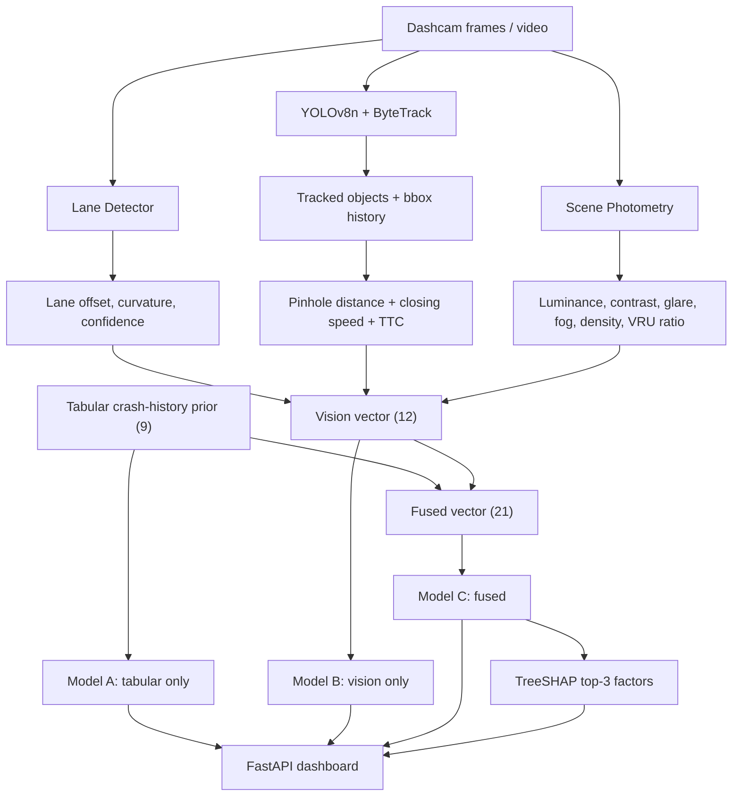

# DriveSense AI — Multi-Modal Driving Perception & Risk Estimation

[](https://python.org)
[](https://fastapi.tiangolo.com)
[](https://ultralytics.com)
[](https://xgboost.readthedocs.io)
[](https://shap.readthedocs.io)

An ADAS-style perception pipeline that turns dashcam video into lane geometry, tracked objects, distance / time-to-collision (TTC) and scene context, then fuses those signals with a crash-history prior to produce an **explainable, per-frame risk score** shown on a live dashboard.

> **Research question:** does adding real-time visual features (lane position, closing speed, scene context) to a crash-history model improve context-aware risk estimation?

**Status:** the perception pipeline and dashboard work end to end on a KITTI sequence. The Model A/B/C benchmark in `src/fusion_model.py` uses **synthetic** labels (a development artifact; it supports no claim about real crashes). Real-data evaluations are in `experiments/exp3_ccd` (Car Crash Dataset) and `experiments/exp1_crss` (NHTSA CRSS); see [Reproducing the IRIS 2027 paper](#reproducing-the-iris-2027-paper) and [Known limitations](#known-limitations).

---

## What it does

| Stage | Module | Output |
| :-- | :-- | :-- |
| 1. Lane detection | `src/lane_detection.py` | Lane lines, lateral offset (m), curvature (1/R), confidence |
| 2. Object tracking | `src/object_detection.py` | YOLOv8n detections with persistent ByteTrack IDs, approach rate |
| 3. Distance & TTC | `src/ttc_distance.py` | Per-object distance (m), closing speed (m/s), TTC (s) |
| 4. Scene features | `src/scene_features.py` | Luminance, contrast, glare, rain/fog index, traffic density, VRU ratio |
| 5. Fusion & explainability | `src/pipeline.py`, `src/explainability.py` | 21-feature vector, risk probability, top-3 TreeSHAP drivers |
| 6. Dashboard | `src/dashboard.py`, `web/` | Live video with synced overlays, risk gauge, SHAP panel, timeline |

## Architecture



## Feature schema

**Tabular prior (9)**: `speed_limit_mph`, `road_alignment`, `road_surface_condition`, `light_condition`, `weather_condition`, `driver_age_group`, `driver_impairment_flag`, `vehicle_type`, `historical_segment_risk`

**Vision (12)**: `lane_offset_m`, `lane_curvature_rad_m`, `lane_confidence`, `min_ttc_sec`, `nearest_obj_distance_m`, `max_approach_rate_mps`, `traffic_density`, `vru_ratio`, `scene_luminance_mean`, `scene_contrast_rms`, `glare_index`, `rain_fog_scatter_index`

**Fused (21)** = tabular + vision, in that order. The ordering is defined in `src/feature_schema.py` and must match the order the models were trained on.

## Key formulas

**Monocular pinhole distance**, with assumed real-world height `H` per class (car 1.5 m, truck 3.2 m, bus 3.4 m, motorbike 1.2 m, person 1.7 m, bicycle 1.4 m):

```
d = (f * H) / h_bbox          f ≈ 720 px (KITTI left colour camera, approximate)
```

**Time-to-collision**, using a 3-frame lookback for closing speed:

```
closing_speed = (d_prev - d_now) / dt
TTC = d_now / closing_speed   if closing_speed > 0.4 m/s, else 10 s (clamped to [0.1, 10])
```

**Lane offset**, assuming a 3.7 m standard lane width and a camera centred on the vehicle axis.

## Design notes

- **Lane detection** uses HLS white/yellow colour masking, Canny, a trapezoidal ROI, probabilistic Hough, slope filtering, and exponential temporal smoothing across frames.
- **Tracking** uses the `ultralytics` built-in ByteTrack (`persist=True`) on a single tracker instance, so IDs persist across frames.
- **Stateful modules** (`LaneDetector`, `ObjectTracker`, `DistanceTTCEstimator`) must be created once and reused across frames. Re-creating them per frame silently disables smoothing, tracking and closing-rate estimation.
- **Dashboard sync:** overlay frames are indexed by the video's own playback time (`frame = floor(t * SRC_FPS)`), and bounding boxes are scaled from source pixels to the canvas. The dashboard video must be a **clean** (un-annotated) H.264 file.

---

## Setup

```bash
python -m venv .venv
.venv\Scripts\activate          # Windows
pip install -r requirements.txt
```

Requires `ffmpeg` on your PATH for building the dashboard video.

## Data

Developed on a **KITTI raw** sequence (synced + rectified, `image_02` left colour camera): 114 frames, 1392×512, ~10 fps.
Download from the [KITTI raw data page](https://www.cvlibs.net/datasets/kitti/raw_data.php) and place the PNG frames in:

```
data/kitti_raw/image_02/data/0000000000.png ...
```

KITTI is released for non-commercial use; see its terms. Cite: Geiger et al., *Vision meets Robotics: The KITTI Dataset*, IJRR 2013.

## Run

Run everything from the project root.

**1. Build the clean dashboard video from the frames**

```bash
ffmpeg -y -framerate 10 -i data/kitti_raw/image_02/data/%010d.png -c:v libx264 -pix_fmt yuv420p -movflags +faststart outputs/real_road_risk_web.mp4
```

**2. Run the full pipeline on that same video** (generates telemetry plus an annotated demo video; `--max-frames 0` means all frames)

```bash
python src/pipeline.py --input outputs/real_road_risk_web.mp4 --output outputs/road_fused_annotated.mp4 --telemetry outputs/demo_telemetry.json --max-frames 0
```

**3. Launch the dashboard**

```bash
python -m src.dashboard
```

Open <http://127.0.0.1:8000>, hard-refresh (`Ctrl+Shift+R`), and press Play. Check <http://127.0.0.1:8000/health> to confirm the video, telemetry frame count and all three models are detected.

> **Rule:** whenever the source footage changes, redo steps 1 and 2 together. The video and `demo_telemetry.json` must come from the same frames, with the same frame count and frame rate (`SRC_FPS` in `web/app.js` must equal the ffmpeg `-framerate`).

### Individual stages (for debugging)

```bash
python -m src.lane_detection        # single-frame lane test
python -m src.object_detection      # single-frame tracking test
python -m src.ttc_distance          # single-frame distance/TTC test
python -m src.scene_features        # single-frame scene features
python -m src.lane_detection_batch  # whole-sequence lane video + telemetry
python -m src.object_detection_batch
python -m src.ttc_distance_batch
```

Single-frame runs show `persistence = 1`, `approach rate = 0` and `TTC = 10 s` by design. These quantities need consecutive frames.

## Dashboard API

| Endpoint | Purpose |
| :-- | :-- |
| `GET /` | Dashboard UI |
| `GET /api/telemetry` | Per-frame telemetry from the last pipeline run |
| `POST /predict` | Risk score, level and top-3 SHAP factors for Model A, B or C |
| `POST /analyze-image` | Estimates lighting, weather and road complexity from an uploaded photo |
| `GET /analytics`, `GET /health` | Prediction log summary, service status |
| `/outputs/*` | Static files (clean video, annotated video, telemetry) |

Risk levels: `LOW` (<25%), `MODERATE` (25–45%), `HIGH` (45–70%), `CRITICAL` (≥70%). If a model file fails to load, `/predict` uses a simple analytical fallback and sets `"fallback": true` in the response. It never silently substitutes a different model.

## Project structure

```
automotive-vision-pipeline/
├── data/kitti_raw/image_02/data/     # KITTI frames (not tracked in git)
├── docs/                              # limitations audit, notes
├── models/
│   ├── model_a_baseline.json          # XGBoost, tabular only
│   ├── model_b_vision.json            # XGBoost, vision only
│   └── model_c_fused.json             # XGBoost, fused
├── outputs/                           # videos + telemetry (not tracked in git)
├── src/
│   ├── feature_schema.py              # feature names, telemetry dataclasses
│   ├── lane_detection.py
│   ├── object_detection.py
│   ├── ttc_distance.py
│   ├── scene_features.py
│   ├── explainability.py              # TreeSHAP + top-3 factors
│   ├── pipeline.py                    # end-to-end orchestration
│   ├── dashboard.py                   # FastAPI server
│   └── *_batch.py                     # per-stage batch runners
├── web/
│   ├── index.html
│   ├── index.css
│   └── app.js
├── requirements.txt
└── README.md
```

Keep `data/`, `outputs/`, `*.mp4` and `*.pt` in `.gitignore`. Large files cause push timeouts and hit GitHub's 100 MB per-file limit.

---

## Evaluation status

The perception modules have been **checked qualitatively** on one 114-frame KITTI sequence: lane overlay, track-ID continuity, plausibility of distance and TTC values, and overlay/video sync on the dashboard.

The Model A/B/C benchmark is trained on **synthetic labels** and is kept only as a development artifact; it has not been validated on real crashes, and no lift is claimed. The real-data evaluation is reported in the IRIS 2027 paper (see below). Remaining work:

- [ ] Confirm how the training labels are produced. If they are synthesized from the same input features, the reported lift is not evidence about real crashes.
- [ ] Add a rule-based baseline (e.g. "alert if TTC < 2 s") and show whether the models beat it.
- [ ] Evaluate on multiple real clips, reporting mean ± std and confidence intervals.
- [ ] Evaluate on a dashcam dataset with labelled accident moments (e.g. DAD, CCD, DoTA), measuring how early the risk score rises before the event.

## Reproducing the IRIS 2027 paper

Everything in the paper is produced by scripts in `experiments/exp3_ccd` (CCD video) and `experiments/exp1_crss` (CRSS); numbers reach the LaTeX source through generated macro files in `paper/`. Run from `experiments/exp3_ccd` with the dataset at `data/CarCrash/` (`videos/Crash-1500/*.mp4`, `videos/Normal/*.mp4`, `videos/Crash-1500.txt`, official lists `splits/train.txt` and `splits/test.txt`):

```bash
python -m venv .venv && .venv/Scripts/pip install -r experiments/exp3_ccd/requirements_exp3.txt xgboost scikit-learn scipy matplotlib pandas shap
export EXP3_CCD_DIR=../../data/CarCrash/videos/Crash-1500
python 00b_build_crash_table.py                                   # onset frame + metadata
python 01_extract_features.py --demo 0                            # accident clips -> results/frame_features
EXP3_CCD_DIR=../../data/CarCrash/videos/Normal EXP3_OUT=results_normal python 01_extract_features.py --demo 0   # normal clips
python 02_build_video_features.py && python 03_temporal_analysis.py
python 05_nuisance_features.py ../../data/CarCrash/videos/Crash-1500 results/nuisance_crash.csv
python 05_nuisance_features.py ../../data/CarCrash/videos/Normal     results/nuisance_normal.csv
python ../../../paper/scripts/pilot.py results ../../../paper     # Sect. 5.1 and its table
python 04_anticipation_eval.py --crash results/frame_features_all.csv --normal-dir results_normal/frame_features \
       --split-dir ../../data/CarCrash/splits --nuisance results/nuisance_crash.csv results/nuisance_normal.csv \
       --out results/eval --paper-dir ../../../paper
python 08_runtime.py ../../data/CarCrash/videos/Crash-1500 ../../../paper
cd ../../../paper && pdflatex main && pdflatex main
```

`01_extract_features.py` accepts `--shard i/n` so several workers can run in parallel (on Windows, raise the workers' process priority). CCD itself must be obtained from its authors (https://github.com/Cogito2012/CarCrashDataset); its normal clips are sampled from BDD100K.

## Known limitations

- **Lane module:** on roads without a painted edge line, the right boundary can lock onto the physical road/gravel edge instead of a marking. Temporal smoothing trades some responsiveness for stability, so sharp real lane changes lag by a few frames.
- **Distance / TTC:** the focal length (~720 px) is specific to KITTI's camera. Per-class heights are population averages, so unusually tall or low vehicles bias the estimate. Using your own camera requires recalibration.
- **Tabular prior:** crash-history inputs are a static assumed prior (speed limit 55 mph, dry, daylight, clear), not derived from location-specific crash data. The sample sequence is a residential street, so the prior does not match it.
- **Dashboard context:** hour, weather and lighting passed to `/predict` are fixed defaults, not inferred from the video.
- **Rain/fog index:** untested against real fog or rain footage.
- **Generalisation:** one sequence, KITTI-style roads. Not validated on Indian road conditions (unmarked lanes, dense mixed traffic, autorickshaws, which COCO-pretrained YOLO does not have as a class).
- **Components:** YOLOv8n, ByteTrack, Canny/Hough, XGBoost and SHAP are used off the shelf. The contribution is the integration and the explainable fusion, not a new architecture.

## Roadmap

1. **Honest evaluation:** multi-clip validation, TTC-threshold baseline, accident-dataset early-warning metric.
2. **Indian-road adaptation:** fine-tune detection on IDD (India Driving Dataset), replace Hough lanes with a learned drivable-area / road-edge model, collect own footage.
3. **Live demo:** run on a phone or laptop with a dashboard-mounted camera; report FPS and latency.
4. **Risk map (optional):** log trips with GPS, aggregate risk per road segment into a heatmap.

## Acknowledgements

KITTI Vision Benchmark Suite, Ultralytics YOLOv8 / ByteTrack, XGBoost, SHAP.
